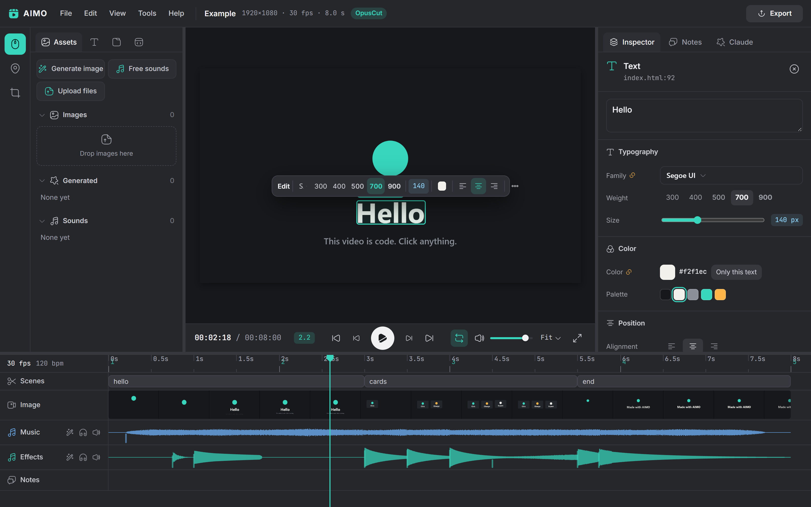
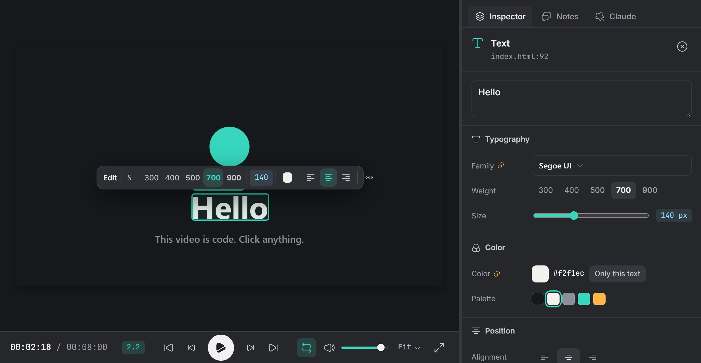
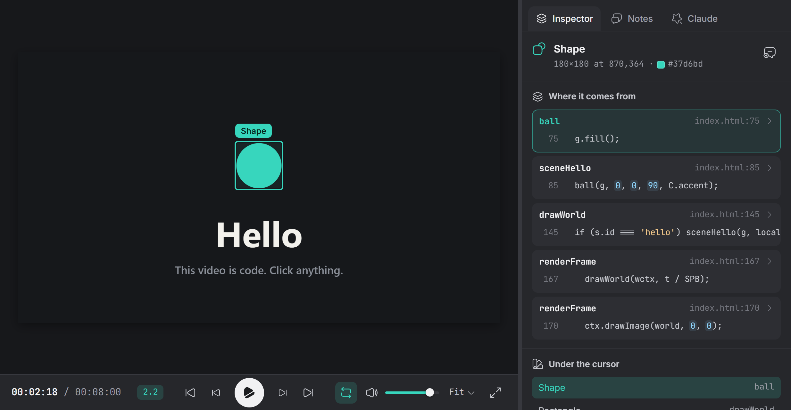
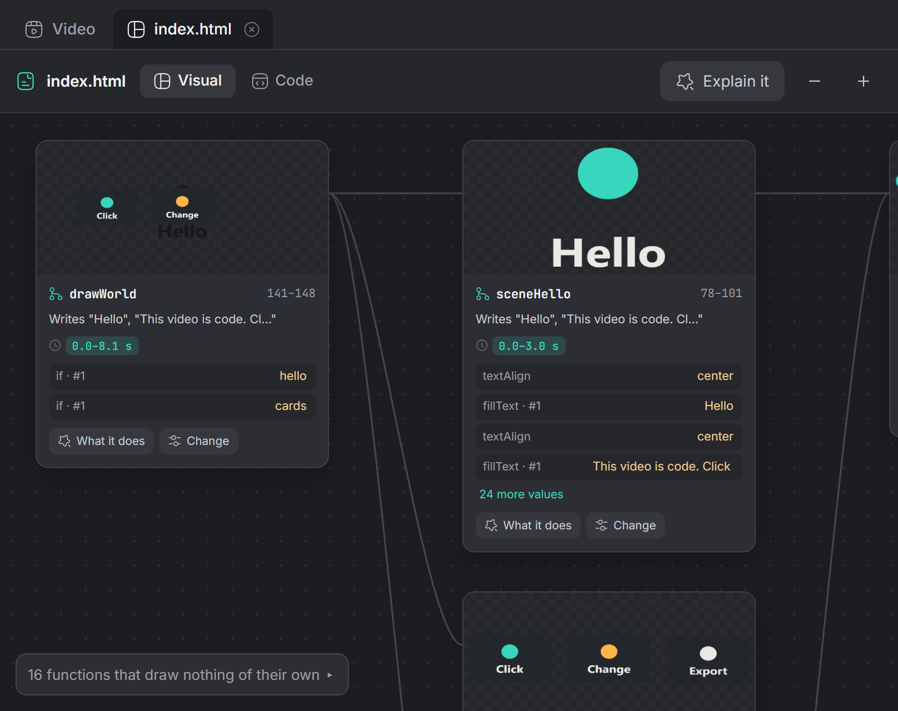
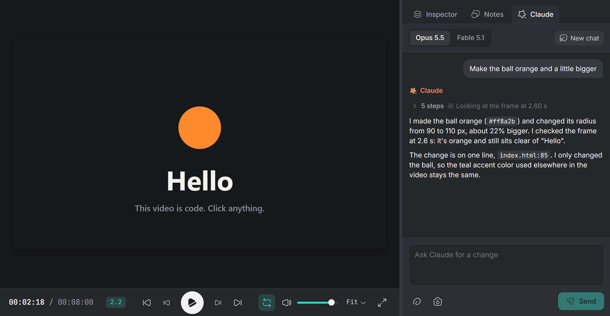
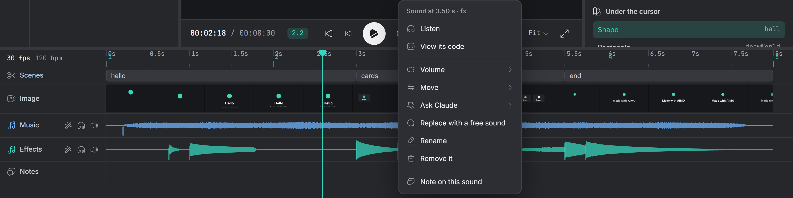
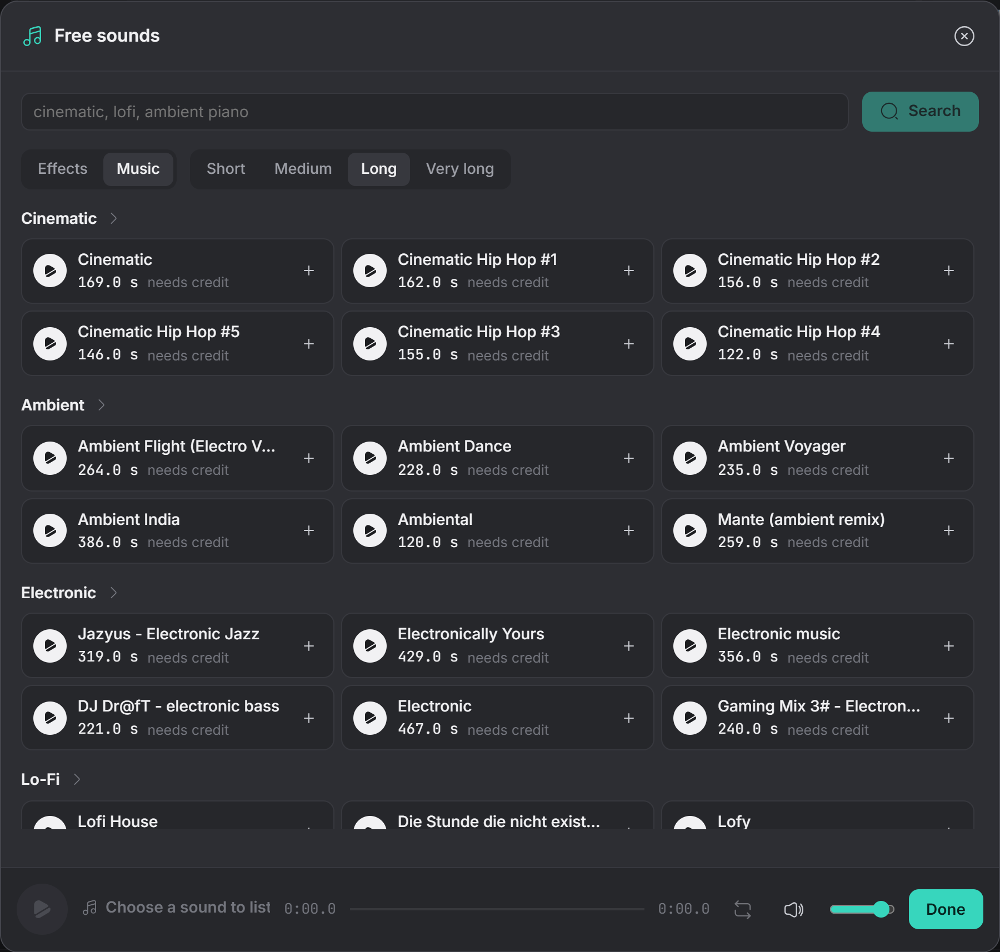
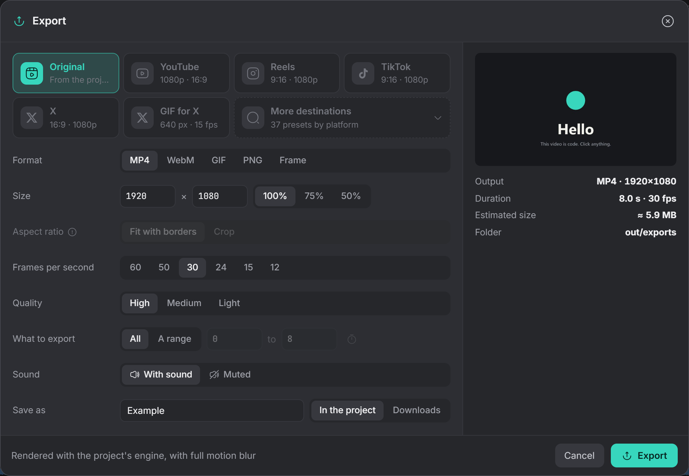
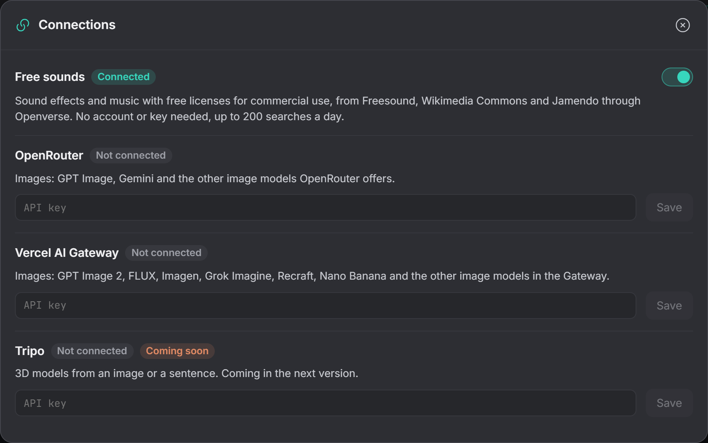
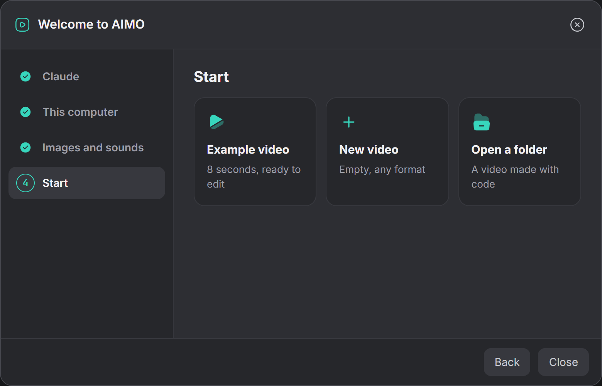

<div align="center">

# Kinora

A video editor for videos made with code.

<a href="https://github.com/sebatanes"></a> <a href="LICENSE"></a> <a href=".claude-plugin/plugin.json"></a> <a href="AGENTS.md"></a>

<br><br>



</div>

<br>

Videos made with code look great until you want to change one thing. The title is a little big, a sound comes in late, the ball should be orange, and every fix means finding the right line or asking the model again. Kinora opens those videos like a timeline. Click anything on the video and you get the code that draws it, a text you can retype, a color you can pick, a sound you can move. Claude sits in the same window, sees the frame you are looking at and changes what you point at. Everything runs on your computer.

## What is inside

- **Click to code.** Every element on the video leads to the line that draws it. Numbers, colors and texts change with a drag.
- **Texts on the video.** Retype any text and change its font, weight, size, color and alignment in place.
- **Claude in the editor.** Ask for a change, attach screenshots, videos, folders or file paths. It sees the same frame you do.
- **Notes on frames.** Mark a point, a zone or a range and leave it for Claude.
- **Sound by track.** One lane per track, mute and solo, free sounds and music with the credits written for you.
- **Images.** Generated through OpenRouter or Vercel AI Gateway with your own key.
- **Export.** MP4, WebM, GIF, PNG or a single frame, with presets for every platform and up to 60 real fps.
- **Agents.** 51 MCP tools cover everything the interface does, for Claude Code, Codex, Cursor or any MCP client.
- **OpusCut included,** the skill that directs these videos so no two look alike.

## Edit on the video

Select a text and a toolbar opens right on the frame. The panel on the side changes the same text, and both stay in sync.



## From pixel to code

Click any shape and the inspector shows where it comes from, call by call. The values in each line are knobs: drag a number, pick a color, retype a string.



The code view draws each function as a card with what it paints, when it shows and the values you can change, so you can edit a video without reading code.



## Claude, with the editor in view

Claude works inside the project, with tools for every part of the editor. It shows what it is doing, how long it has been working and asks with option cards when a decision is yours. One request is one undo step.



## Sound

Right click a sound to listen to it, change its volume, move it, rename it, swap it for a free one or ask Claude about it. The same works on a whole track.



Free sound effects and music come connected, with no account or key. Listen before adding, and the credit line goes to `CREDITS.md` on its own.



## Export

Original size or a preset for YouTube, Reels, TikTok, X and 37 more. Choose the format, size, frames per second, quality, a range and the sound.



## Connections

Free sounds are on from the start. Image generation takes your own OpenRouter or Vercel AI Gateway key, stored only on your computer.



## Install

You need [Node.js 20+](https://nodejs.org), [Python 3.10+](https://www.python.org/downloads/), [ffmpeg](https://ffmpeg.org) and [Claude Code](https://claude.com/claude-code) signed in with your account. Nothing to install with npm: the server, the MCP server and the interface come built.

As a Claude Code plugin:

```
/plugin marketplace add sebatanes/kinora
/plugin install kinora@sebastian-atanes
```

Then run `/kinora`, or `/kinora path/to/video`.

On its own:

```bash
git clone https://github.com/sebatanes/kinora.git
node kinora/server/kinora-server.js
```

and open http://127.0.0.1:4870.

The first time, a welcome checks Claude, Python and ffmpeg, installs the Python packages with one button and opens an example video with a short tour.



| Agent | Connect |
|:--|:--|
| Claude Code | the plugin above, or `claude mcp add kinora -- node /path/to/kinora/server/kinora-mcp.js` |
| Codex | `[mcp_servers.kinora]` in `~/.codex/config.toml`, see [AGENTS.md](AGENTS.md) |
| Cursor and others | `{ "mcpServers": { "kinora": { "command": "node", "args": ["/path/to/kinora/server/kinora-mcp.js"] } } }` |

## How Claude connects

Kinora runs the `claude` command on your computer, signed in with your own account, the same way you use it in a terminal. It never sees or stores a Claude key. If you are not signed in yet, run `claude auth login` once.

## Develop

```bash
npm install
npm run dev     # live reload from the sources
npm run build   # builds ui/dist, server/kinora-server.js and server/kinora-mcp.js
```

Tested on Windows. macOS and Linux should work and are not tested yet.

<br>

<div align="center">

Made by [Sebastián Atanes](https://github.com/sebatanes) together with uxKero, a personal friend, under the [MIT License](LICENSE).

</div>
